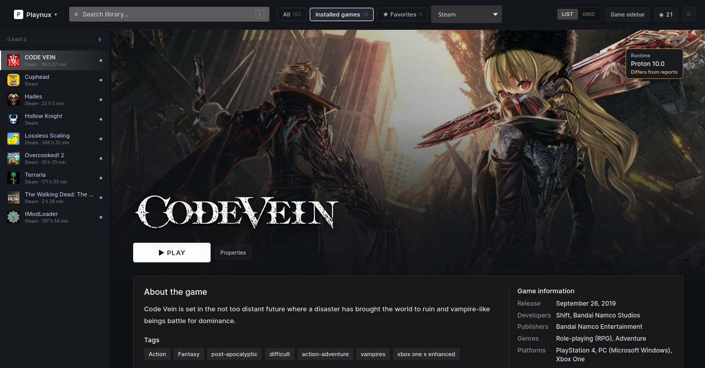
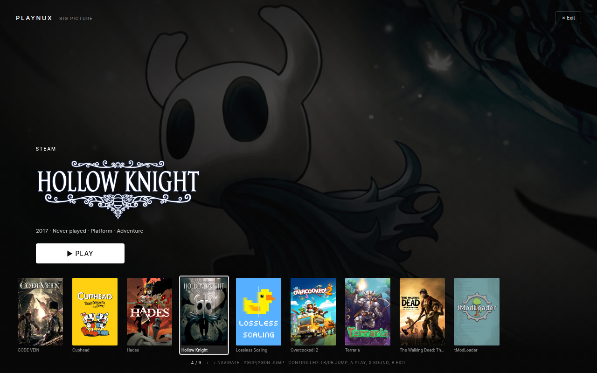

<h1 align="center">Playnux</h1>

<p align="center">
  A game library manager for Linux, inspired by Playnite.
</p>

<p align="center">
  
  
  
  
</p>

Playnux brings your games together on Linux. Browse your library in list, grid, or Big Picture mode, launch installed games, and see community compatibility reports alongside their artwork and trailers.

Playnux was written from scratch. Playnite's source code was consulted as a reference for the library architecture, data models, and features.



| Cover grid | Big Picture |
| --- | --- |
|  |  |

## Features

- **Stores:** Steam, Epic Games, and GOG integrations
- **More sources:** Linux shortcuts, Flatpak games, and ROMs
- **Emulators:** detects supported emulators and launches ROMs through them
- **Proton picker:** suggests the best Proton version for each game using recent ProtonDB reports
- **Metadata and artwork:** official store data, IGDB, and SteamGridDB
- **Views:** list, cover grid, and Big Picture
- **Local-first:** your library lives in a local SQLite database on your machine

Built with Go and [Wails](https://wails.io/).

## Alpha 0.1.0

This is an early alpha for Linux x86-64. The core works, but expect rough edges and bugs. Some games require a store client, an emulator, or a configured compatibility runner.

Plugins, themes, and the community catalog are not ready yet. See the [roadmap](docs/ROADMAP.md).

## Install

Download the package for your system from [GitHub Releases](https://github.com/Ywtoo/Playnux/releases). Run the appropriate command from your download directory.

```sh
# Fedora, Nobara, and other DNF-based distributions
sudo dnf install ./playnux-0.1.0-alpha-linux-amd64.rpm

# Debian and Ubuntu systems with WebKitGTK 4.1
sudo apt install ./playnux-0.1.0-alpha-linux-amd64.deb
```

To install as your user, use the binary archive. It needs the GTK3, WebKitGTK 4.1, and X11 runtime libraries.

```sh
tar -xzf playnux-0.1.0-alpha-linux-amd64.tar.gz
cd playnux-0.1.0-alpha-linux-amd64
sh install.sh
```

The installer adds a desktop entry and links `~/.local/bin/playnux` to the installed binary in `~/.local/opt/playnux/`. Open Playnux from the application menu, or run `~/.local/bin/playnux --version` to verify the installation. `sh install.sh --uninstall` removes the app and keeps your library and preferences.

To verify downloads against `SHA256SUMS`, run this in the download directory:

```sh
sha256sum --check --ignore-missing SHA256SUMS
```

## Metadata and API keys

Playnux fetches game information and artwork from IGDB and SteamGridDB. For now, both services use **your own API keys**:

1. Create a key on each service (IGDB through Twitch, SteamGridDB in your account preferences).
2. In Playnux, open **Settings → Metadata**.
3. Paste the keys for IGDB and SteamGridDB.

Keys are stored only on your machine. I’ll explore whether a metadata service just for Playnux could remove the need for personal keys and compare approaches before choosing one. See the [roadmap](docs/ROADMAP.md).

Game data is provided by [IGDB.com](https://www.igdb.com/).

## Updates and language

Playnux checks GitHub Releases on startup. You can also choose **Check for updates** in the application menu. The binary archive installation can download and verify a compatible update from within Playnux. Restart the app to finish. Package-managed installs use the release page to get the new RPM or DEB.

Library migrations run on startup inside a SQLite transaction. Playnux saves a private backup beside the database before it migrates an existing library.

English is the default. Choose **Settings → Appearance and performance → Language** to use Brazilian Portuguese. Missing translations fall back to English.

## Privacy

Playnux runs entirely on your machine. Your library and preferences are stored locally. Store logins are used only to connect to the stores from your own computer and are never shared with anyone.

Playnux contacts external services only to fetch game metadata, artwork, and compatibility reports (IGDB, SteamGridDB, and ProtonDB).

## Build from source

Install Go 1.26 or newer, Node.js 22.12 or newer, npm, `pkg-config`, and the GTK3, WebKitGTK 4.1, and X11 development libraries. On Fedora, the development packages are `gtk3-devel`, `webkit2gtk4.1-devel`, and `libX11-devel`.

```sh
go install github.com/wailsapp/wails/v3/cmd/wails3@v3.0.0
npm --prefix ui/frontend ci
make test
make build
make package-linux
```

With `wails3` on your `PATH`, `make build` creates `bin/playnux`. `make package-linux` adds the RPM, DEB, binary archive, and checksums under `bin/release/` for the build machine's architecture.

## Support the project

Playnux is free and open source, and it is built and maintained by one person in their spare time. If it is useful to you, a donation helps me keep working on it and cover future hosting costs.

- [GitHub Sponsors](https://github.com/sponsors/Ywtoo)
- [Ko-fi](https://ko-fi.com/your-username)
- Pix (Brazil): `your-pix-key`

Not able to donate? Starring the repository, reporting bugs, and sharing Playnux with other Linux gamers helps just as much.

## Roadmap

See the [roadmap](docs/ROADMAP.md) for alpha stabilization, plugins, themes, the community catalog, and an exploration of metadata options.

## Feedback and contributing

Bug reports and ideas are welcome in [Issues](https://github.com/Ywtoo/Playnux/issues). When reporting a bug, include your Linux distribution, the affected game or integration, and steps to reproduce it. If available, include the message from **Game notifications**.

## License

Released under the [MIT license](LICENSE.md). See the [third-party credits](CREDITS.md).
