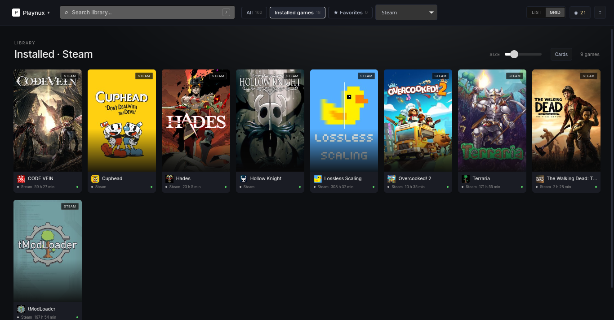

# Playnux

Playnux brings your games together on Linux. Browse your library in list, grid, or Big Picture mode, launch installed games, and see community compatibility reports alongside their artwork and trailers.


| Cover grid | Big Picture |
| --- | --- |
|  |  |

## Alpha 0.1.0

The first alpha targets Linux x86-64. Playnux integrates with Steam, Epic Games, and GOG, and can import Linux shortcuts, Flatpak games, and ROMs. Certain games require a store client, an emulator, or a configured compatibility runner.

## Install

Download the package for your system from [GitHub Releases](https://github.com/Ywtoo/Playnux/releases). Run the appropriate command from your download directory.

```sh
# Fedora, Nobara, and other DNF-based distributions
sudo dnf install ./playnux-0.1.0-alpha-linux-amd64.rpm

# Debian and Ubuntu systems with WebKitGTK 4.1
sudo apt install ./playnux-0.1.0-alpha-linux-amd64.deb
```

To install as your user, use the binary archive. It needs the GTK3, WebKitGTK 4.1, and X11 runtime libraries.

```sh
tar -xzf playnux-0.1.0-alpha-linux-amd64.tar.gz
cd playnux-0.1.0-alpha-linux-amd64
sh install.sh
```

The installer adds a desktop entry and links `~/.local/bin/playnux` to the installed binary in `~/.local/opt/playnux/`. Open Playnux from the application menu or run `~/.local/bin/playnux --version` to verify the installation. `sh install.sh --uninstall` removes the app and keeps your library and preferences.

To verify downloads against `SHA256SUMS`, run `sha256sum --check --ignore-missing SHA256SUMS` in the download directory.

## Updates and language

Playnux checks GitHub Releases on startup. You can also choose **Check for updates** in the application menu. The binary archive installation can download and verify a compatible update from within Playnux. Restart the app to finish. Package-managed installs use the release page to get the new RPM or DEB.

Library migrations run on startup inside a SQLite transaction. Playnux saves a private backup beside the database before it migrates an existing library.

English is the default. Choose **Settings → Appearance and performance → Language** to use Brazilian Portuguese. Missing translations fall back to English.

## Build from source

Install Go 1.26 or newer, Node.js 22.12 or newer, npm, `pkg-config`, and the GTK3, WebKitGTK 4.1, and X11 development libraries. On Fedora, the development packages are `gtk3-devel`, `webkit2gtk4.1-devel`, and `libX11-devel`.

```sh
go install github.com/wailsapp/wails/v3/cmd/wails3@v3.0.0
npm --prefix ui/frontend ci
make test
make build
make package-linux
```

With `wails3` on your `PATH`, `make build` creates `bin/playnux`. `make package-linux` adds the RPM, DEB, binary archive, and checksums under `bin/release/` for the build machine’s architecture.

## Roadmap and feedback

See the [roadmap](docs/ROADMAP.md) for alpha stabilization, planned plugins and themes, and the community catalog.

When reporting a bug, include your Linux distribution, the affected game or integration, and steps to reproduce it. If available, include the message from **Game notifications**. [Report an issue](https://github.com/Ywtoo/Playnux/issues)

Released under the [MIT license](LICENSE.md). See the [third-party credits](CREDITS.md).
